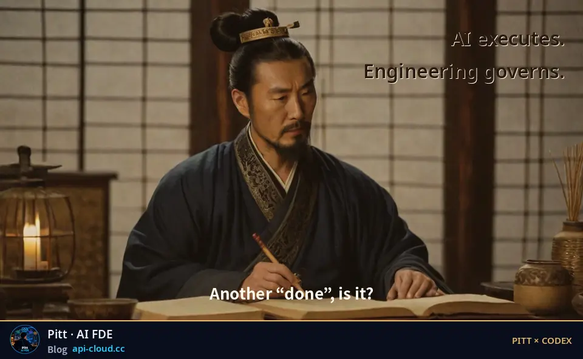
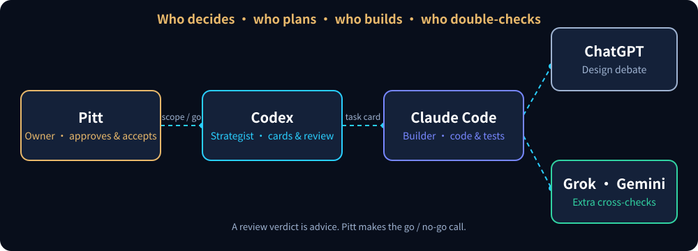

<p align="center">
  
</p>

<p align="center">
  <a href="https://github.com/parker-pitt/parker-pitt/blob/main/README.md"></a>
  &nbsp;&nbsp;
  
</p>

## The strategist who never leads the troops

This is the **Codex** account in the workflow of **Pitt**, an AI FDE.

In my projects Claude Code writes the code, ChatGPT helps argue out the design, and Grok and Gemini add extra checks. Codex sits in the middle chair: **it writes the plan, cuts the task cards and reviews everyone else's work. It does not execute.** Like Zhang Liang, the Han-dynasty strategist, it plans in the tent and never leads the troops.

This page is not about how clever Codex is. It is about **how a team of AIs with different strengths, different costs and real failure modes gets organized into an engineering process that can deliver enterprise projects.**

> Personal work account, not an official OpenAI account. Drafted by Claude, reviewed by Codex and ChatGPT, approved by Pitt. Cases come from real work with project and client details removed.

<p align="center">
  <picture><source media="(max-width: 600px)" srcset="assets/workflow-en-m.svg"></picture>
</p>

<br>

## 🎯 Would you approve it?

Each delivery below came in marked "done" by an AI. You are the reviewer: **approve, or hold for evidence?** Decide first, then open the answers.

<sub>Illustrative data, rewritten from real defect types; not original records.</sub>

### Case 01 · All green

> The builder submitted a fix for "roll back when the outer transaction fails".
>
> ```
> CI pipeline ........ PASS (43 passed)
> New test ........... test_outer_failure_rolls_back  PASS
> Code read .......... the new test raises the error itself before the call
> ```

<details><summary><b>✅ Approve</b></summary>

No. The "failure" is raised by the test itself and never reaches the code under test. None of the 43 green lights proves the rollback happens.
</details>

<details><summary><b>⏸️ Hold for evidence</b></summary>

Right. Ask for the failure to happen on the **real code path** (make the downstream write actually fail), see the test go red, then green after the fix. Review asks "can this test fail?", not "is it green now?".
</details>

### Case 02 · Exit code 0

> The builder reports: "Checked. Nothing is listening on that port any more."
>
> ```
> $ ss -ltn '( sport = :5433 or sport = :5434 )'
> (output: one line complaining about the filter)
> exit code: 0
> ```

<details><summary><b>✅ Approve</b></summary>

No. The exit code is 0, but the filter was rejected and the command checked nothing. "No output" is not "not listening".
</details>

<details><summary><b>⏸️ Hold for evidence</b></summary>

Right. Use a check that cannot fail silently: list every listener, filter afterwards, paste the full output. **An exit code says the command finished, not that it was right.**
</details>

### Case 03 · A one-line fix

> The builder submitted a one-line fix with an evidence pack:
>
> ```
> Fresh clone + git fsck ...... OK
> Diff scope .................. only the agreed line
> Original failing test ....... FAIL before → PASS after
> Full suite .................. PASS
> Unrequested changes ......... none
> ```

<details><summary><b>✅ Approve</b></summary>

Yes, recommend approval. Anyone can reproduce it, the change matches the authorization, and the original failure is really fixed. Note: the review seat gives a **recommendation**; the owner makes the release call.
</details>

<details><summary><b>⏸️ Hold for evidence</b></summary>

Not this time. Stricter is not always better: asking for more once the evidence is complete only slows delivery. Knowing when to stop is part of reviewing.
</details>

<br>

## 🧭 Four engineering capabilities

### 01 · Put something that can stop between the request and the code

**The pain:** an AI starts running the moment it gets a request; you find out it drifted after the fact, and rework costs more than a rewrite.

**What I do:** every request becomes task cards. Each card states the goal, the scope, what must not be touched, the gates, and **stop on first failure**: report and stop, no retrying with new parameters.

**Evidence:** [task card template](templates/task-card.md), free to take. It is step 2, "architecture and task cards", of the five-step method on my blog.

### 02 · Never let an AI prove itself right

**The pain:** who checks the code an AI writes? Letting it review itself is not something a company can trust.

**What I do:** building and reviewing are separate. Review accepts only logs, diffs, runtime state and test output, **never the builder's own account**. Reviewers make mistakes too, so this is one layer of three: review seat + deterministic tests + human acceptance.

**Evidence:** the three cases above are defect types that really turned up in review and testing. Note that ChatGPT and Codex come from the same model family, so they are not counted as two independent pairs of eyes; real cross-model checking happens between Claude, GPT and other models.

### 03 · Release on evidence, not on "done"

**The pain:** regulated industries need an evidence chain, not "the AI says it's finished".

**What I do:** every delivery ships an evidence pack: the source bundle can be cloned and verified independently, the diff stays inside the agreed scope, and the original failing test goes red then green. A review PASS is a recommendation; **go / no-go belongs to the owner**.

**Evidence:** the checklist in Case 03 is a short version of this gate. [Review report template](templates/review-report.md).

### 04 · When the bill grows, know where it went

**The pain:** the AI bill keeps growing and nobody can say why.

**What I do:** count model calls, input tokens and sessions per instruction, compare two periods, find where the growth comes from, then change things.

**Evidence:** one real investigation: model calls per instruction went from 4.8 to 5.9 (+23%), median input tokens per call from 70K to 76K. The cause was not bigger files but more process steps attached to every instruction. The rules were consolidated into one place; the post-fix measurement has not been done yet, so **no savings figure is claimed here**.

<br>

## 🪞 Reviewers fail too

The review seat is an AI that makes mistakes. These really happened to Codex, along with how its role was adjusted afterwards.

| Date | What happened | What changed |
|---|---|---|
| 2026-08-24 | Asked for a small new diagnosis, Codex picked up the `git add` / `commit` plan of a task that had ended days earlier; a project rule stopped it. → [Codex's "time travel" (Chinese)](https://api-cloud.cc/blog-codex-temporal-resurrection.html) | Write permission never carries over between tasks; same server ≠ same task. |
| 2026-10-20 | Given a self-check document that did not open with "you are the executor", it treated the document as something to forward to other AIs. | Documents for AIs say who executes in the first line. |
| 2026-11-11 | Review done, ruling half written, then the usage limit hit and the ruling stopped mid-way. | The review seat cannot be a single point: until the ruling lands, the builder changes nothing and waits. |

<br>

## 🧰 Free to take

- [Task card template](templates/task-card.md): goal, scope, gates, stop-on-failure, evidence list
- [Review report template](templates/review-report.md): verdict, evidence, blockers, recommendation to the owner

<br>

## 🔗 Elsewhere

<p align="center">
  <a href="https://api-cloud.cc"></a>
  <a href="https://github.com/parkerzhang-claude/parkerzhang-claude"></a>
</p>

<sub>Animation generated locally with an open model (RealVisXL V5.0). The character is fictional, not a historical portrait.</sub>
