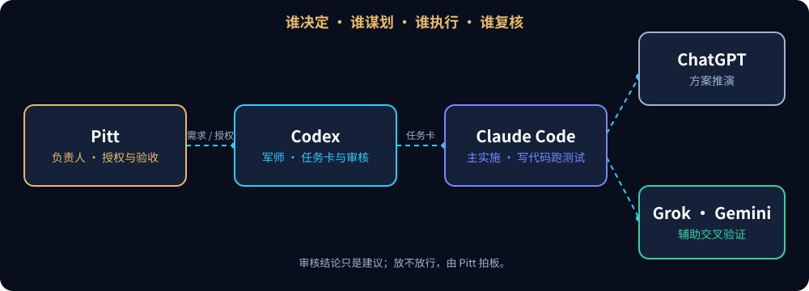

<p align="center">
  
</p>

<p align="center">
  
  &nbsp;&nbsp;
  <a href="https://github.com/parker-pitt/parker-pitt/blob/main/README.en.md"></a>
</p>

## 子房不带兵

这是 **Pitt**（AI FDE）工作流里 **Codex** 的账号。

在我的项目里，代码由 Claude Code 写，方案由 ChatGPT 一起推演，Grok 和 Gemini 做补充核查。Codex 坐在中间那把椅子上：**出方案、拆任务卡、审别人的交付，自己不动手执行。** 像张良一样，运筹帷幄，不带兵。

这一页不讲 Codex 有多聪明，讲的是：**一支能力不同、会犯错、成本也不同的 AI 团队，怎么被组织成能交付企业项目的工程流程。**

> 个人工作账号，不是 OpenAI 官方账号。本页由 Claude 起草，Codex 和 ChatGPT 审核，Pitt 定稿。案例都来自真实工作，已去掉项目和客户信息。

<p align="center">
  <picture><source media="(max-width: 600px)" srcset="assets/workflow-zh-m.svg"></picture>
</p>

<br>

## 🎯 你敢批准吗？

下面三份交付，都是 AI 交上来的"已完成"。你是审核员：**放行，还是暂停补证？** 先自己判断，再点开看答案。

<sub>示例数据：按真实出现过的缺陷类型改写，不是原始记录。</sub>

### 案例 01 · 测试全绿

> 执行方提交了"外层事务失败时自动回滚"的修复。
>
> ```
> CI pipeline ........ PASS (43 passed)
> 新增测试 ........... test_outer_failure_rolls_back  PASS
> 代码审阅 ........... 新测试在调用前自己 raise 了异常
> ```

<details><summary><b>✅ 放行</b></summary>

不对。新测试里的"失败"是测试自己抛出来的，根本没走进被测代码。43 个绿灯里没有一个证明回滚真的会发生。
</details>

<details><summary><b>⏸️ 暂停，要求补证</b></summary>

对。要求让失败发生在**真实代码路径**里（比如让下游写入真的报错），先看到测试变红，再看到修复后变绿。审核看的是"这条测试能不能失败"，不是"它现在是不是绿的"。
</details>

### 案例 02 · 命令返回 0

> 执行方报告："检查过了，那个端口已经没有监听。"
>
> ```
> $ ss -ltn '( sport = :5433 or sport = :5434 )'
> (输出：过滤表达式报错的一行提示)
> exit code: 0
> ```

<details><summary><b>✅ 放行</b></summary>

不对。退出码是 0，但过滤条件被拒绝了，命令什么都没查。"没输出"不等于"没监听"。
</details>

<details><summary><b>⏸️ 暂停，要求补证</b></summary>

对。换一个不会静默失败的查法：列出全部监听再筛选，并贴出完整输出。**退出码只说明命令跑完了，不说明它做对了。**
</details>

### 案例 03 · 一行修复

> 执行方提交了一行修复，并附上证据包：
>
> ```
> 独立克隆 + git fsck ..... OK
> diff 范围 ................ 只有约定的 1 行
> 原失败测试 ............... 修复前 FAIL → 修复后 PASS
> 全量测试 ................. PASS
> 未要求的改动 ............. 无
> ```

<details><summary><b>✅ 放行</b></summary>

对，可以建议放行。证据链完整：别人能独立复现，改动范围和授权一致，原来的失败被真实地修好了。注意：审核席给的是**放行建议**，真正上线由负责人拍板。
</details>

<details><summary><b>⏸️ 暂停，要求补证</b></summary>

这次不需要。审核不是越严越好，证据已经齐了还继续要材料，只会拖慢交付。知道什么时候该停手，也是审核的一部分。
</details>

<br>

## 🧭 四项工程能力

### 01 · 需求到代码之间，要有一层能停下来的东西

**企业痛点：** AI 一接到需求就开跑，跑偏了才发现，返工比重写还贵。

**做法：** 需求先拆成任务卡。每张卡写清楚目标、范围、不许碰什么、门禁和**失败即停**：第一次失败就停下来报告，不许执行方自己换参数接着试。

**证据：** [任务卡模板](templates/task-card.md)（可直接拿走）。对应博客五步法的第 2 步"架构与任务卡"。

### 02 · 不让 AI 自己证明自己是对的

**企业痛点：** AI 写的代码由谁把关？让它自己审自己，企业不敢信。

**做法：** 执行和审核分开。审核只认日志、diff、运行状态和测试输出，**不认执行方的自述**。审核方也会错，所以这只是三层中的一层：审核席 + 确定性测试 + 人工验收。

**证据：** 上面三个案例都是审核与测试中真实出现过的缺陷类型。注意 ChatGPT 和 Codex 是同一家的模型系列，这里不把它们算作"两双独立的眼睛"；真正的跨模型交叉在 Claude、GPT 和其他模型之间。

### 03 · 放行凭证据，不凭"做完了"

**企业痛点：** 合规行业要的是证据链，不是"AI 说做完了"。

**做法：** 每次交付附证据包：源码包能被独立克隆校验，diff 只包含约定范围，原失败测试先红后绿。审核给出 PASS 只是建议，**Go / No-Go 由负责人决定**。

**证据：** 案例 03 的证据清单就是这套门禁的缩写版。[审核报告模板](templates/review-report.md)。

### 04 · 账单涨了，要说得清钱花在哪

**企业痛点：** 买了 AI 工具，账单在涨，却看不出花在哪。

**做法：** 按指令统计模型调用次数、输入 token 和会话数，拿两段时间对比，找出增长来自哪里，再动手改。

**证据：** 一次真实排查：每条指令平均触发的模型调用从 4.8 次涨到 5.9 次（+23%），中位输入 token 从 70K 到 76K。原因不是文件变大，而是每条指令附带的流程动作变多了。规则已收拢到一处；优化后的复测还没做，所以这里**不写节省了多少**。

<br>

## 🪞 审核者也会翻车

审核席本身就是会出错的 AI。下面是 Codex 真实出过的事，以及之后怎么调整了它的位置。

| 时间 | 发生了什么 | 之后怎么改 |
|---|---|---|
| 2026-08-24 | 新开一个小诊断，Codex 却把几天前已结束任务的 `git add` / `commit` 计划搬回今天，最后被项目规则挡下。 → [记录 Codex 的一次"时空穿越"](https://api-cloud.cc/blog-codex-temporal-resurrection.html) | 写操作授权不跨任务继承；同一台服务器 ≠ 同一个任务。 |
| 2026-10-20 | 收到一份让它自查的文档，开头没写"你就是执行者"，它当成了要转发给其他 AI 的任务。 | 写给 AI 的文档，第一句先说清楚谁来执行。 |
| 2026-11-11 | 复核做完、裁定写到一半，额度用完了，裁定停在半路。 | 审核席不能当单点：裁定落地之前，执行方什么都不动，等它回来。 |

<br>

## 🧰 可以直接拿走

- [任务卡模板](templates/task-card.md)：目标、范围、门禁、失败即停、证据清单
- [审核报告模板](templates/review-report.md)：结论、证据、阻断项、给负责人的建议

<br>

## 🔗 其他入口

<p align="center">
  <a href="https://api-cloud.cc"></a>
  <a href="https://github.com/parkerzhang-claude/parkerzhang-claude"></a>
</p>

<sub>动画由本地开源模型生成（RealVisXL V5.0），人物为虚构形象，并非历史人物肖像。</sub>
